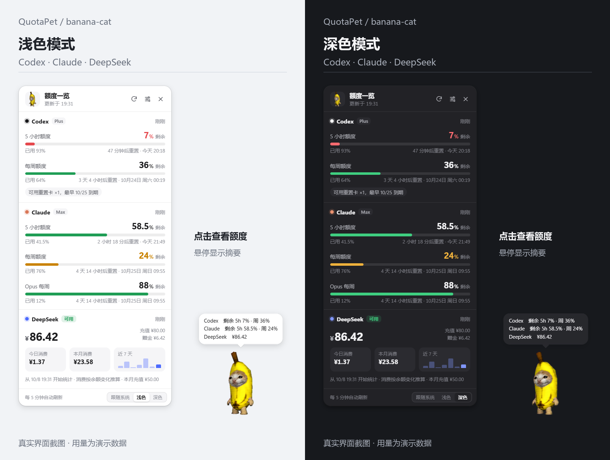
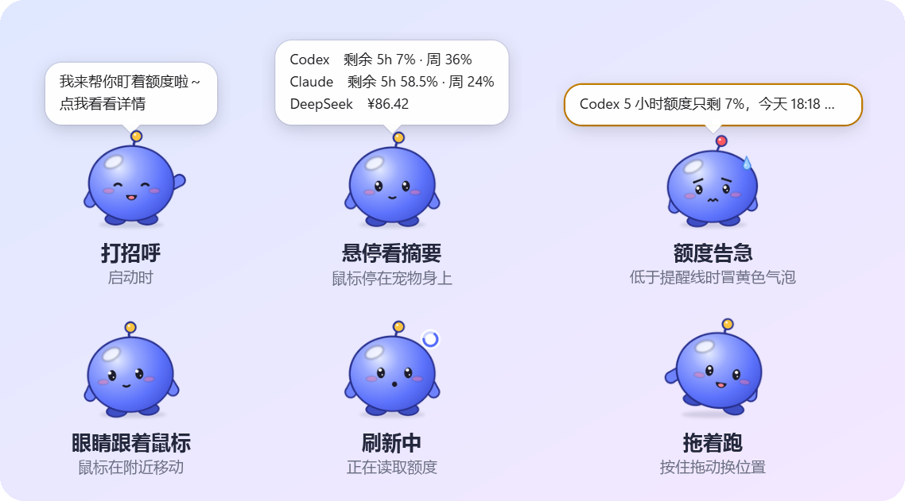

<div align="center">


# 额度桌宠 QuotaPet

**支持 Codex 官方宠物格式的 Windows 额度桌宠。**

让你在 Codex 里养的猫，顺手帮你盯着额度。点一下，查看 Codex / Claude 订阅用量，以及 DeepSeek 余额与消费趋势。




</div>

## 能看什么

| 服务 | 显示内容 |
|---|---|
| **Codex** | 5 小时与每周额度、剩余百分比、重置时间、套餐、可用额度重置卡及每张卡的到期时间 |
| **Claude** | 5 小时与每周额度；使用 Claude Code 登录凭据时，可显示接口返回的 Opus / Sonnet 周额度和精确重置时间 |
| **DeepSeek** | 账户余额、充值与赠金明细、今日 / 本月消费估算、近 7 天消费趋势 |

- **复用 Codex 宠物**：直接读取本机已安装的 Codex 自定义宠物，兼容官方 v1 / v2 精灵图格式，支持透明 PNG / WebP。
- **Codex 令牌直查**：优先使用本机登录令牌查询，正常刷新不启动 `codex.exe`，无需额外填写 OpenAI API Key。
- **桌面交互**：单击查看额度、拖动移动位置、悬停显示摘要；透明区域可穿透鼠标，v2 宠物支持眼睛跟随鼠标。
- **用量提醒**：订阅额度或余额低于设定值时，猫猫会做出提醒动作并弹出气泡；额度窗口重置时会蹦起来庆祝“额度回满啦”。
- **陪伴互动**：快速甩开它会飞出去，碰到屏幕边会弹，半空中按住能接住；在它身上来回蹭会冒爱心；闲着时沿任务栏走几步、看场合说句话；离开电脑会睡觉，回来汇报离开期间的额度变化。
- **头顶小图标**：💦 额度紧张、💤 睡着了、❗ 全部读取失败，不用悬停也能一眼看到状态。
- **日常使用**：支持浅色 / 深色 / 跟随系统、托盘菜单、宠物大小调整和开机自启。

<div align="center">

</div>

> 截图使用本机的香蕉猫 `banana-cat`，额度与余额来自 `test/demo-data.js` 的演示数据。猫猫只是展示示例，你可以换成自己的 Codex 宠物。

## 快速开始

需要 **Windows 10 / 11** 和 **Node.js 22.12+**。

```bash
git clone https://github.com/sj122/quota-pet.git
cd quota-pet
npm install
npm start
```

启动后，宠物会出现在桌面右下角，托盘里也会多一个图标。

1. **Codex**：在本机用 ChatGPT 订阅账号登录过 Codex 后，桌宠会自动读取可用登录凭据。
2. **Claude**：用 `claude` 登录过 Claude Code 时优先查询用量接口；也可以使用 Claude 桌面端已有的用量记录。
3. **DeepSeek**：右键宠物 → **设置…**，填入 DeepSeek API Key，点“保存并验证”。Windows 加密可用时，Key 通过 DPAPI 加密保存在本机。
4. **换宠物**：右键宠物 → **切换宠物**，选择本机已有的 Codex 自定义宠物。

只使用其中一家也可以，在设置里关闭暂时不用的服务即可。桌面快捷方式可通过 `npm run shortcut` 创建；开机自启在右键菜单里开启。

<details>
<summary>Electron 下载或启动遇到问题</summary>

国内网络下载较慢时，可以先在 PowerShell 设置镜像，再运行 `npm install`：

```powershell
$env:ELECTRON_MIRROR="https://npmmirror.com/mirrors/electron/"
npm install
```

如果安装后提示找不到 Electron，手动运行 `node node_modules/electron/install.js`，再执行 `npm start`。

</details>

## 支持 Codex 官方宠物格式

QuotaPet 兼容 Codex 桌面端自定义宠物使用的 `pet.json` 与精灵图目录格式。已安装在本机的自定义宠物可以直接复用，无需重新制作动画或转换图片。

默认扫描两个位置；设置了 `CODEX_HOME` 时，第一个位置改为该目录下的 `pets`：

```text
~/.codex/pets/<宠物目录>/
%APPDATA%/quota-pet/pets/<宠物目录>/
```

每只宠物至少包含：

```text
my-cat/
├── pet.json
└── spritesheet.webp   # 也可以使用 PNG，在 pet.json 中填写实际文件名
```

`pet.json` 示例：

```json
{
  "id": "my-cat",
  "displayName": "我的猫猫",
  "spritesheetPath": "spritesheet.webp",
  "spriteVersionNumber": 2
}
```

| 格式 | 精灵图尺寸 | 动画支持 |
|---|---|---|
| **v1** | 1536 × 1872，8 列 × 9 行 | 待机、奔跑、挥手、跳跃、失败、等待、忙碌、完成等基础状态 |
| **v2** | 1536 × 2288，8 列 × 11 行 | 基础状态，以及 16 个方向的看向帧，可跟随鼠标 |

标准单帧尺寸为 **192 × 208**。图片使用透明背景的 PNG 或 WebP，文件名与 `spritesheetPath` 保持一致。

新安装宠物后，在右键菜单中选择 **切换宠物 → 重新扫描宠物**。没有找到可用素材时，会显示一个备用小圆球。Codex 自定义宠物的创建方式可参考 [OpenAI 官方宠物说明](https://learn.chatgpt.com/docs/pets)。

## 怎么操作

| 操作 | 效果 |
|---|---|
| 单击宠物 | 打开或收起额度面板 |
| 鼠标悬停 | 显示额度摘要 |
| 按住拖动 | 移动宠物，播放奔跑动画；慢慢放下就停在原地 |
| 快速甩开 | 宠物飞出去，撞到屏幕边会弹，最后落在任务栏上 |
| 飞在半空时按住 | 接住它，松手就停在那里，不会打开面板 |
| 在宠物身上来回蹭 | 撸猫：冒爱心、呼噜两声 |
| 右键宠物或托盘 | 刷新、换宠物、调整大小、宠物行为开关、设置、开机自启、隐藏或退出 |
| 面板内按 `Esc` / `F5` | 收起面板 / 立即刷新 |
| 悬停“可用重置卡” | 显示每张卡的到期时间和剩余时长 |

默认每 **5 分钟**刷新一次，可在设置里调整。打开面板时，如果数据超过 1 分钟未更新，也会触发刷新；Codex / Claude 的额度窗口到了重置时间，也会自动补刷一次。默认提醒线为订阅额度剩余 **10%**、DeepSeek 余额 **¥10**。

电脑闲置 5 分钟后宠物会睡觉，刷新降到半小时一次；回来时立即补刷，离开超过 15 分钟或期间额度有变化（重置、被后台任务用掉、DeepSeek 扣费）会冒气泡汇报。散步只沿任务栏上沿、在你最后放下它的位置附近走，被放在半空时不会乱走。这些行为都可以在右键菜单的“宠物行为”或设置里单独关闭。

## 数据来源与边界

| 服务 | 查询方式 | 说明 |
|---|---|---|
| **Codex** | 优先读取 `~/.codex/auth.json` 中的 ChatGPT 登录令牌，直接查询 Codex 后台用量接口；有可用重置卡时再查一次重置卡列表，取每张卡的到期时间 | 正常刷新不需要打开 Codex 桌面端。令牌缺失、失效或直连失败时，才启动一次 `codex app-server`，通过 `account/rateLimits/read` 备用查询，查询完退出。 |
| **Claude** | 优先使用 `~/.claude/.credentials.json` 查询用量接口；否则读取 Claude 桌面端的 `plan-usage-history.json` | 直查可获取接口提供的精确重置时间；桌面端记录受其采样频率限制，重置时间为估算，手动刷新无法让采样更快。 |
| **DeepSeek** | 官方 `GET /user/balance` | API 提供余额；今日 / 本月消费根据本地余额下降量估算，从首次查询开始累计，余额上涨记为充值。 |

Codex 订阅登录令牌与 OpenAI API Key 是两种凭据。Codex 直连地址属于其后台接口，未作为稳定的公开 HTTP API 文档化，因此保留官方 app-server 备用查询。

## 本地存储

- 查询请求只发往对应服务，不上传到本项目自建服务器。网络默认跟随系统代理，也可以手动指定代理。
- 桌宠只读 Codex、Claude 的登录缓存，不自行刷新或改写令牌；Codex 备用查询时，官方 app-server 按自身机制处理续期。
- 配置与用量历史保存在 `%APPDATA%/quota-pet/`。DeepSeek Key 在 Windows 加密可用时以加密形式存储；余额历史只记录 Key 的哈希，用于区分账号。

宠物在锁屏、休眠或显示器布局变化后会重新校准窗口和鼠标穿透。鼠标穿透由主进程按页面上传的“当前帧透明度图”自行计算，页面卡住也不会让宠物变成点不动的空壳；页面不再处理鼠标消息、崩溃或失去响应时会自动重载，必要时整窗重建，无需手动干预。恢复相关事件保存在 `%APPDATA%/quota-pet/interaction.log`（轮转备份为 `interaction.log.1`），记录唤醒、锁屏、显示器变化、穿透状态切换、页面无应答和通道停摆的时间；日志不包含令牌、额度或鼠标移动轨迹。

## 开发

| 命令 | 用途 |
|---|---|
| `npm test` | 测试令牌查询与备用通路、数据解析、消费统计、动画和鼠标交互 |
| `npm run test:interaction` | 在真实 Electron 演示窗口验证系统通知、虚拟显示布局变化和页面卡死/崩溃后的拖动与点击，以及甩出去落地、半空接住，结果写入 `out/interaction-test/report.json` |
| `npm run selftest` | 使用本机登录状态查询真实数据，并输出自检结果 |
| `npx electron . --demo --snapshot=<目录>` | 使用演示数据测试交互，保存宠物、面板和设置截图 |
| `npx electron . --snapshot=<目录>` | 使用本机真实数据测试交互并截图 |

交互演示测试使用输出目录下的独立配置，不修改用户的主题、位置或隐藏设置；虚拟布局测试不会改变 Windows 实际分辨率。真实锁屏、休眠和远程控制切换仍需在日常使用中确认。

```text
main.js               窗口、托盘、菜单、IPC 与刷新调度
preload.js            页面可用的最小接口
src/providers/        Codex / Claude / DeepSeek 数据源
src/quota.js          三家服务的刷新与状态管理
src/pets.js           宠物扫描与精灵图识别
renderer/physics.js   抛掷、弹跳与散步的物理（主进程和宠物页面共用）
renderer/             宠物、额度面板与设置界面
test/                 自动化测试与演示数据
```

## 声明与许可

本项目为独立个人项目，与 OpenAI、Anthropic、DeepSeek 没有隶属或背书关系。“支持 Codex 官方宠物格式”指素材格式兼容。自定义宠物素材的权利归各自权利人所有。

代码采用 [MIT](LICENSE) 许可证。
